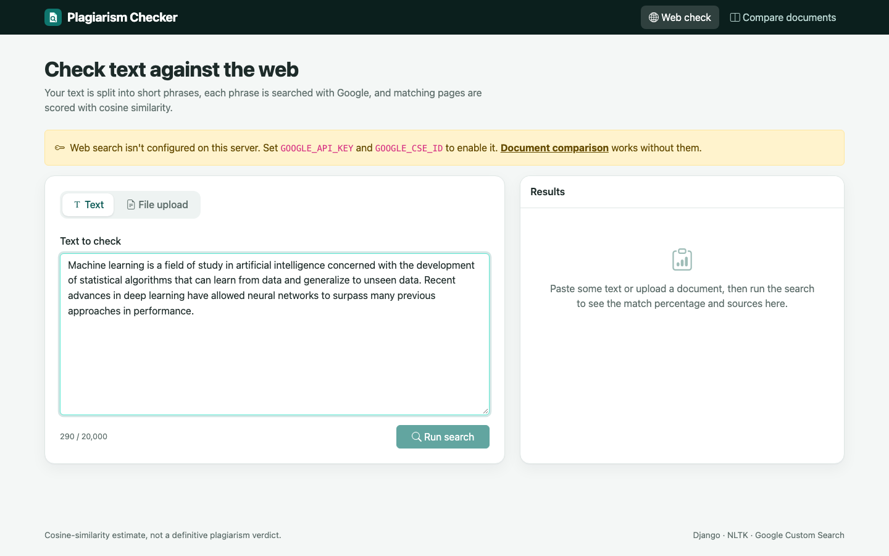
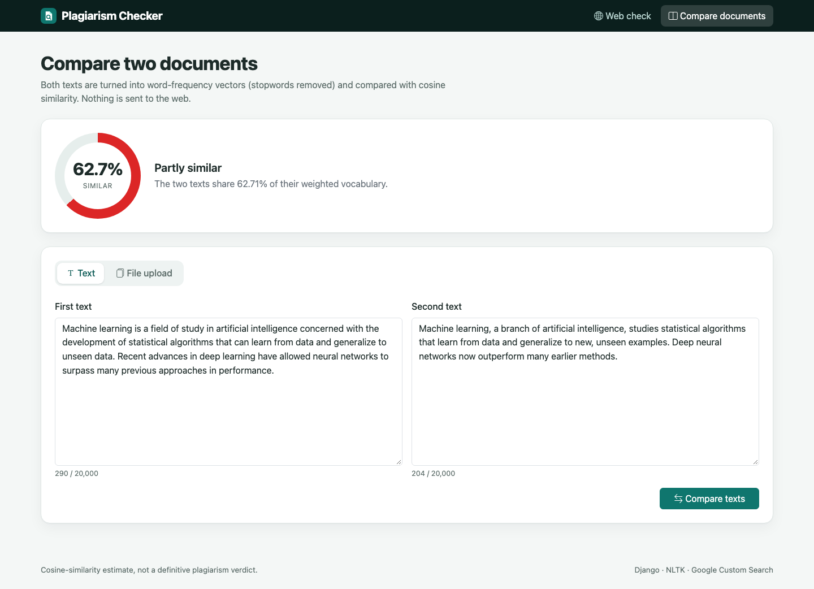
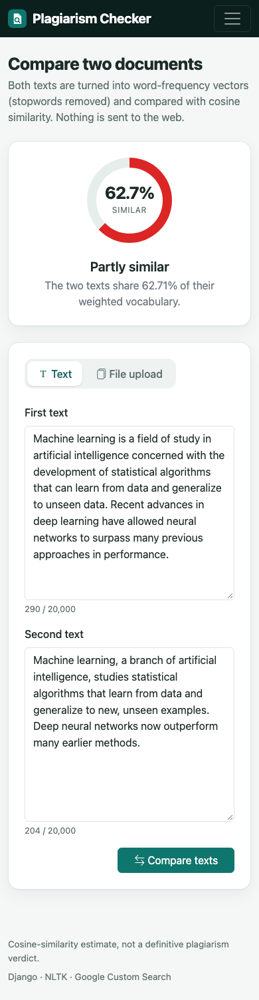

# Plagiarism Checker

A Django web app that estimates plagiarism. It compares text or documents against web search results, or compares two documents with each other, using cosine similarity.


[](https://github.com/VamsiKrishnaThota03/plagiarism-checker/actions/workflows/ci.yml)
[](https://github.com/VamsiKrishnaThota03/plagiarism-checker/actions/workflows/codeql.yml)
[](LICENSE)

## Overview

The app has two tools:

1. **Web plagiarism check**: the input text is split into sentences, stopwords are removed (NLTK), and the words are grouped into 9-word query chunks. Each chunk (up to `MAX_SEARCH_QUERIES`, 25 by default) is searched with the Google Custom Search JSON API. The top 5 result snippets are scored with cosine similarity, and the best-matching links are combined into an overall plagiarism percentage with source links.
2. **Document comparison**: two texts are turned into word-frequency vectors over their combined vocabulary, and the app reports their cosine similarity as a percentage.



## Features

- Paste text, or upload a `.txt`, `.docx` or `.pdf` file, and check it against the web.
- Get an overall match percentage (shown as a gauge) and the matching source URLs with their share.
- Compare two pasted texts, or two uploaded files (the types can differ), and get a similarity score with a plain-language verdict.
- Stopword filtering with the NLTK English stopword list. The list is downloaded automatically on first use, with a built-in fallback when offline.
- Clear messages for missing API credentials, empty or oversized input, and unreadable files; a loading state while the web search runs.
- Input limits (`MAX_TEXT_CHARS`, `MAX_UPLOAD_BYTES`) and a per-check API call cap (`MAX_SEARCH_QUERIES`).
- Tests for the algorithms and views, with the Google API mocked.
- A `Procfile` for running under gunicorn on Heroku-style platforms; static files served by WhiteNoise.

## Tech stack

- Python 3.10+, Django 5.2 LTS
- NLTK (stopwords)
- python-docx, pypdf
- requests (Google Custom Search JSON API)
- Bootstrap 5.3 + Bootstrap Icons (CDN)
- WhiteNoise, gunicorn
- SQLite (Django default; the app defines no models)

## Project structure

```
Plagiarism-Checker/
├── manage.py
├── Procfile                      # web: gunicorn Plagiarism_Checker.wsgi
├── requirements.txt
├── .env.example
├── docs/screenshots/
├── Plagiarism_Checker/           # Django project (settings, urls, wsgi/asgi)
└── plagiarismchecker/            # Django app
    ├── algorithm/
    │   ├── main.py               # query building + web similarity scoring
    │   ├── webSearch.py          # Google Custom Search calls
    │   ├── ConsineSim.py         # cosine similarity of two strings
    │   ├── fileSimilarity.py     # document-vs-document similarity
    │   └── stopwords.py          # NLTK stopwords with offline fallback
    ├── extract.py                # text from .txt / .docx / .pdf uploads
    ├── forms.py
    ├── templates/pc/             # base, index, doc_compare + partials
    ├── static/pc/                # app.css, app.js, favicon
    ├── tests.py
    ├── url.py
    └── views.py
```

## Getting started

### Prerequisites

- Python 3.10 or later
- For the web check: a Google API key with the Custom Search JSON API enabled, and a Programmable Search Engine ID (`cx`). Document comparison works without them.

### Install

```bash
git clone https://github.com/VamsiKrishnaThota03/plagiarism-checker.git
cd Plagiarism-Checker
python -m venv venv
source venv/bin/activate          # Windows: venv\Scripts\activate
pip install -r requirements.txt
cp .env.example .env              # then edit .env (DJANGO_DEBUG=true for local development)
```

### Environment variables

| Variable | Required | Default | Purpose |
|----------|----------|---------|---------|
| `DJANGO_SECRET_KEY` | yes, unless `DJANGO_DEBUG=true` | none | Django signing key |
| `DJANGO_DEBUG` | no | `false` | `true` for local development only |
| `DJANGO_ALLOWED_HOSTS` | no | `localhost,127.0.0.1` | Comma-separated host names |
| `DJANGO_CSRF_TRUSTED_ORIGINS` | behind an HTTPS proxy | empty | e.g. `https://your-app.example.com` |
| `GOOGLE_API_KEY` | for the web check | empty | Custom Search JSON API key |
| `GOOGLE_CSE_ID` | for the web check | empty | Programmable Search Engine ID (`cx`) |
| `MAX_SEARCH_QUERIES` | no | `25` | Max API calls per check (the free tier allows 100 per day) |
| `MAX_TEXT_CHARS` | no | `20000` | Max characters per text box / extracted document |
| `MAX_UPLOAD_BYTES` | no | `5242880` | Max upload size |
| `SQLITE_PATH` | no | `./db.sqlite3` | SQLite file (only used by Django's built-in apps) |

### Run

```bash
python manage.py migrate
python manage.py runserver        # http://127.0.0.1:8000
```

### Tests

```bash
DJANGO_DEBUG=true python manage.py test plagiarismchecker
```

### Deploying

Build: `pip install -r requirements.txt && python manage.py collectstatic --noinput && python manage.py migrate`. Start: the `Procfile` (`gunicorn Plagiarism_Checker.wsgi`). Set `DJANGO_SECRET_KEY`, `DJANGO_ALLOWED_HOSTS`, `GOOGLE_API_KEY` and `GOOGLE_CSE_ID`.

## Routes

| Method | Path                | Purpose                                              |
| ------ | ------------------- | ---------------------------------------------------- |
| GET    | `/`                 | Web plagiarism check page                            |
| POST   | `/test/`            | Check pasted text (`q`) against the web              |
| POST   | `/filetest/`        | Check an uploaded `.txt` / `.docx` / `.pdf` (`docfile`) |
| GET    | `/compare/`         | Document comparison page                             |
| POST   | `/twofiletest1/`    | Compare two pasted texts (`q1`, `q2`)                |
| POST   | `/twofilecompare1/` | Compare two uploaded files (`docfile1`, `docfile2`)  |

GET requests to the POST-only paths redirect to their page.
| GET    | `/admin/`           | Django admin                                         |

## Screenshots

| Document comparison | Mobile |
|---|---|
|  |  |

## Known limitations

- The web check sends one Google API request per query chunk, synchronously, so long documents take a while and use quota quickly. There is no rate limiting per visitor.
- Results only reflect what Google's top 5 snippets contain; it is an estimate, not proof of plagiarism.
- Scanned PDFs (images without a text layer) can't be read.


## Deployment security

`python manage.py check --deploy` reported `SECURE_HSTS_SECONDS` and
`SECURE_SSL_REDIRECT` as unset (`security.W004`, `security.W008`). Both are now
configured, along with `SESSION_COOKIE_HTTPONLY`, `SameSite=Lax` on both
cookies, `SECURE_CONTENT_TYPE_NOSNIFF`, `X_FRAME_OPTIONS = DENY` and
`SECURE_REFERRER_POLICY`.

They sit inside `if not DEBUG` and each is overridable by an environment
variable, deliberately: **enabling HSTS is effectively irreversible** for the
length of `max-age`, because a browser that has seen the header refuses plain
HTTP to that host until it expires. Someone deploying onto a plain-HTTP host
needs to turn it off up front rather than discover the lockout afterwards.

| Variable | Default | Notes |
| --- | --- | --- |
| `DJANGO_SSL_REDIRECT` | `true` | Set `false` behind a proxy that already redirects |
| `DJANGO_HSTS_SECONDS` | `31536000` | Set `0` to disable |
| `DJANGO_HSTS_INCLUDE_SUBDOMAINS` | `true` | |
| `DJANGO_HSTS_PRELOAD` | **`false`** | Left off on purpose — browser preload submission is permanent |
| `DJANGO_SECURE_COOKIES` | `true` | Set `false` only for plain-HTTP local runs |

`check --deploy` is now completely clean. The resulting `W021` preload warning
is acknowledged via `SILENCED_SYSTEM_CHECKS`, scoped to that single check and
**conditional** — it disappears the moment `DJANGO_HSTS_PRELOAD=true` is set.
Acknowledging it beats leaving a standing warning, because a check that always
prints something trains everyone to stop reading it.

CI runs `check --deploy --fail-level WARNING`, so any genuinely new warning
fails the build, and a second step enables preload to prove the silence is
conditional rather than a blanket suppression.

## Continuous integration

| Job | What it proves |
| --- | --- |
| `test` (Python 3.11, 3.12) | `manage.py check`, that no migration is missing (`makemigrations --check`), and the test suite |
| `deploy-check` | `check --deploy --fail-level WARNING` is clean, and a missing `DJANGO_SECRET_KEY` stops the app rather than falling back to the insecure local key |
| `docker` | The image builds |

CodeQL runs over Python weekly and on every push; Dependabot watches pip,
Actions and the Dockerfile.

## Docker

```bash
printf 'DJANGO_SECRET_KEY=%s\n' \
  "$(python3 -c 'import secrets;print(secrets.token_urlsafe(64))')" > .env

docker compose up --build
open http://localhost:8000
```

Runs under gunicorn as a non-root user, with static files collected at build
time so the container needs no write access to the image. The port publishes to
`127.0.0.1` only; gunicorn binds all interfaces *inside* the container, which is
correct — the publish is the security boundary.
